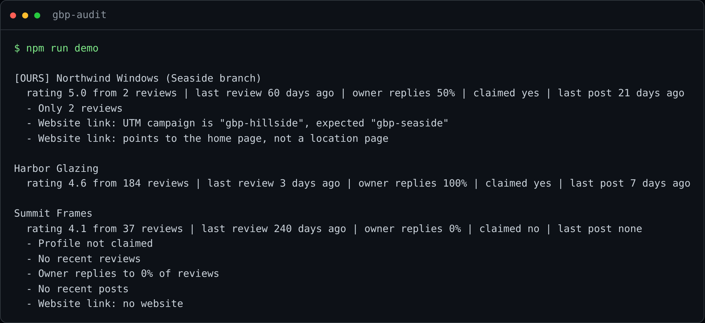

# Google Business Profile Audit

**See exactly where your Google Maps profile loses customers to local competitors, as a short
monthly list of fixes instead of an afternoon of clicking.**

For a local business, the Google Maps profile is often the first impression and the main source of
calls. Reviews, replies, posts and a correctly tracked website link decide who gets chosen. This
audit reads your profile and your competitors' profiles every month and tells you what to fix
first.



## Results in production

In production since November 2026 for a local home-improvement business and its competitors:

| | |
|---|---|
| **Coverage** | **13 profiles a month**: the business's own locations and its main competitors |
| **Time** | About **3 hours a month** of manual checking replaced by an unattended job *(estimate: 15 minutes per profile by hand)* |
| **First finding** (in testing) | The business's own website link carried another location's tracking campaign and pointed to the home page, so visits from that profile were credited to the wrong branch |

## Features

- **Side-by-side benchmark:** rating, number of reviews, how recent the last review is, how often
  the owner replies, whether the profile is claimed and whether it posts updates.
- **Prioritized fixes:** each profile gets a concrete list (unclaimed profile, too few reviews,
  no recent reviews, owner does not reply, no recent posts, broken or untracked website link).
- **Tracking check:** verifies that each location's website link uses its own UTM campaign and
  lands on the right page, so marketing reports are trustworthy.
- **Evidence kept:** text and a screenshot of every profile, every month.
- **Resumable and respectful:** progress is logged so an interrupted run continues where it
  stopped, with one to two minutes between profiles; it stops at the first sign of a block.
- **Monthly report in Notion:** one page per month, ready to share with the team.

## Quick start

The public module (from profile text to signals and fixes) runs on fictional data with no
dependencies.

**With Docker**

```bash
docker compose run --rm demo
docker compose run --rm test
```

**With Node.js 20+**

```bash
npm run demo
npm test
```

## Tech stack

Node.js, Playwright, Notion API, Windows Task Scheduler, Docker for the demo. It shares its
browser session handling and Notion publishing with the
[AI Visibility Tracker](https://github.com/miguelmoga2002-alt/ai-visibility-tracker).

## About this repo

A public, sanitized view of a private production job. `src/signals.mjs` is the production logic,
translated to English; the browser automation, real competitors and credentials stay private.
Built by [Miguel Morales García](https://miguelmoralesgarcia.es): I designed the system and its
rules, and wrote the code with AI assistants, choosing a different one for each part of the job.
More projects: [automation-portfolio](https://github.com/miguelmoga2002-alt/automation-portfolio).

## Want this for your business?

I build audits and reporting like this for local businesses. Contact me through
[miguelmoralesgarcia.es](https://miguelmoralesgarcia.es) or LinkedIn.

## License

MIT
